# 🔬 ResearchLens AI — Research Paper Intelligence Platform

[](https://www.python.org/)
[](https://fastapi.tiangolo.com/)
[](https://www.trychroma.com/)
[](https://console.groq.com/)
[](https://streamlit.io/)

**ResearchLens AI** is an end-to-end, production-style scientific paper intelligence platform designed to ingest, comprehend, retrieve, compare, and benchmark academic literature. Built with **FastAPI**, **ChromaDB**, **PyMuPDF**, **Groq (Free Tier)**, and **Streamlit**, it provides strictly grounded answers, verified page citations, multi-paper comparative matrices, 8-section structured paper summaries, and a reproducible Information Retrieval (IR) evaluation benchmark.

---

## 📌 Problem Statement

Students, researchers, and AI engineers face exponential growth in arXiv preprints and scientific papers. Key challenges include:
1. **Hallucination Risk:** Standard LLMs invent plausible-sounding equations, datasets, and citation numbers when asked technical questions.
2. **Citation Verification Gaps:** General RAG tools rarely provide exact page-level source traceability or link claims directly to original paper excerpts.
3. **Synthesis Overhead:** Manually contrasting multiple papers across architectures, dataset benchmarks, limitations, and trade-offs takes hours.
4. **Lack of Retrieval Quality Auditing:** Most implementations deploy vector search without measuring whether relevant passages actually appear in top-$K$ candidates.

**ResearchLens AI** solves these issues with a strict grounding pipeline, Reciprocal Rank Fusion (RRF) hybrid retrieval, page-aware chunking, unvalidated citation guards, and an evaluation playground.

---

## 🌟 Key Features

- **📥 Dual Ingestion Channels:**
  - **PDF Upload:** Page-by-page extraction via PyMuPDF with header/footer cleanup, de-hyphenation, SHA-256 deduplication, and scanned/image PDF rejection.
  - **Live arXiv Search & Import:** Query the official arXiv API by topic, title, author, or keyword and import papers directly into local storage.
- **🧩 Page-Aware Intelligent Chunking:** Preserves exact source page numbers and detects academic section headings (Abstract, Introduction, Methodology, Experiments, Results, Discussion, Limitations, Conclusion).
- **🔎 Tri-Mode Retrieval Engine:**
  - **Dense Vector Search:** Local sentence-transformers embeddings (`all-MiniLM-L6-v2`) in ChromaDB.
  - **Keyword Search:** BM25Okapi for exact acronym and entity matching.
  - **Hybrid RRF (Default):** Reciprocal Rank Fusion ($k=60$) combining semantic and lexical retrieval to prevent vocabulary mismatch.
- **⚡ Free-Tier Groq RAG:** Uses Groq's high-throughput free-tier inference (`llama-3.3-70b-versatile` / `llama-3.1-8b-instant`) with zero paid API dependencies.
- **🎯 Strict Citations & Hallucination Guard:**
  - System prompts instruct the model to cite evidence using stable markers `[S1]`, `[S2]`.
  - The backend validates every citation against supplied chunks, flagging and isolating unvalidated citations.
- **⚖️ Multi-Paper Comparative Matrix:** Compare 2 to 5 papers across 9 standardized dimensions with a synthesized contrast of similarities, differences, trade-offs, and open research questions.
- **📑 Structured 8-Section Summaries:** Generates grounded summaries with an **Export to Markdown** feature.
- **🧪 RAG Evaluation Playground:** Measures reproducible IR metrics across 32 benchmark questions spanning 5 categories:
  - **Hit Rate@K**
  - **Mean Reciprocal Rank (MRR)**
  - **Recall@K**
  - **Precision@K**
  - Interactive Plotly visualizations and Human-in-the-Loop review audit.

---

## 🏗️ Architecture Diagram

```mermaid
graph TD
    subgraph UI ["Frontend (Streamlit)"]
        Dashboard["Dashboard & Metrics"]
        Discover["arXiv Search & Import"]
        Upload["PDF Upload & Chunk Tuning"]
        Chat["Research Chat with Citations"]
        Compare["Multi-Paper Comparison Matrix"]
        Summary["Structured 8-Section Summary"]
        Eval["RAG Evaluation Playground (Plotly)"]
        Settings["Settings & Groq Setup"]
    end

    subgraph API ["Backend API (FastAPI)"]
        PaperRouter["/papers (Upload, Import, Search, Delete)"]
        ChatRouter["/chat (Grounded RAG)"]
        CompareRouter["/papers/compare (Cross-Paper Synthesis)"]
        EvalRouter["/evaluation (HitRate, MRR, Recall)"]
        HealthRouter["/health (Diagnostics)"]
    end

    subgraph Core ["Services & Processing"]
        PDFSvc["PyMuPDF Extractor"]
        ChunkSvc["Page-Aware Chunking & Section Detector"]
        EmbedSvc["Local SentenceTransformers (all-MiniLM-L6-v2)"]
        RetrieveSvc["Hybrid RRF (Dense + BM25)"]
        CitationSvc["Citation Validator & Excerpt Builder"]
        RAGSvc["Groq LLM Client (llama-3.3-70b)"]
        EvalSvc["IR Metrics Engine"]
    end

    subgraph Storage ["Local Persistent Storage"]
        Chroma["ChromaDB Vector Store (data/chroma_db)"]
        MetaDB["Paper Metadata (data/papers_metadata.json)"]
        Files["Stored PDFs (data/papers)"]
        BenchDB["Benchmark Questions (data/evaluation)"]
    end

    UI -->|HTTP / REST| API
    API --> Core
    Core --> Storage
```



---

## 💻 Technology Stack

| Layer | Technology | Rationale |
|---|---|---|
| **Backend API** | FastAPI, Pydantic v2 | High-performance asynchronous API, strict schema validation, and automatic OpenAPI docs. |
| **PDF Processing** | PyMuPDF (fitz) | Fast, reliable page-by-page text extraction with native coordinate and metadata support. |
| **Local Embeddings** | `sentence-transformers` (`all-MiniLM-L6-v2`)| 384-dimensional dense vectors generated locally without requiring any paid API. |
| **Vector Database** | ChromaDB (Persistent) | Local, zero-configuration vector store with cosine similarity. |
| **Lexical Search** | `rank-bm25` | Industry-standard BM25Okapi for exact keyword and terminology recall. |
| **Fusion Algorithm** | Reciprocal Rank Fusion (RRF)| Merges dense semantic ranks and BM25 lexical ranks with constant $k=60$. |
| **LLM Inference** | Groq Python SDK | Free-tier, ultra-low-latency inference with LLaMA 3.3 70B Versatile. |
| **Frontend UI** | Streamlit, Plotly | Clean research-oriented interface, responsive dataframes, and interactive charts. |
| **Testing** | Pytest, FastAPI TestClient | Comprehensive unit and integration test suite runnable completely offline. |

---

## 🚀 Getting Started (Windows PowerShell)

### 1. Prerequisites
- **Python 3.11+** installed (`python --version`)
- **Git** (optional, for version tracking)

### 2. Clone or Open Workspace
```powershell
cd e:\PROJECTS\researchlens-ai
```

### 3. Create and Activate Virtual Environment
```powershell
# Create virtual environment
python -m venv .venv

# Activate in PowerShell
.\.venv\Scripts\Activate.ps1
```
*(If script execution is disabled in PowerShell, run `Set-ExecutionPolicy -ExecutionPolicy RemoteSigned -Scope CurrentUser`)*

### 4. Install Dependencies
```powershell
python -m pip install --upgrade pip
python -m pip install -r requirements.txt
```

### 5. Configure Environment Variables
Copy `.env.example` to `.env`:
```powershell
Copy-Item .env.example .env
```

Open `.env` in any text editor and configure your free Groq API key:
```ini
GROQ_API_KEY=gsk_your_actual_key_here
GROQ_MODEL=llama-3.3-70b-versatile
```

> **Note:** Even without a `GROQ_API_KEY`, the application will start successfully! Document extraction, page-aware chunking, local vector embedding, BM25 indexing, and hybrid passage retrieval are 100% functional offline.

---

## 🏃 Running the Application

### Start the FastAPI Backend (Terminal 1)
```powershell
python scripts/run_backend.py
```
- Backend runs at: `http://127.0.0.1:8000`
- Interactive OpenAPI Docs: `http://127.0.0.1:8000/docs`
- System Health Check: `http://127.0.0.1:8000/health`

### Start the Streamlit Frontend (Terminal 2)
```powershell
streamlit run frontend/streamlit_app.py
```
- Frontend UI opens in your browser at: `http://localhost:8501`

---

## 🧪 Running Automated Tests

All tests run completely offline with mock fixtures and synthetic in-memory PDFs (no API calls or costs required):

```powershell
python -m pytest tests/ -v
```

### Test Suite Coverage:
- `test_pdf_processing.py`: Validates page text extraction, scanned/image PDF rejection, title heuristics, and SHA-256 hashing.
- `test_chunking.py`: Validates page-aware chunking, overlap preservation, section detection, and non-empty guarantees.
- `test_citations.py`: Validates citation extraction regex, citation map verification, and unvalidated citation detection.
- `test_retrieval.py`: Tests BM25 tokenization and near-identical chunk deduplication.
- `test_rag_prompts.py`: Tests prompt construction, evidence block injection, and missing API key fallback behavior.
- `test_api_health.py`: Validates `/health` diagnostics and status codes.
- `test_evaluation_metrics.py`: Mathematically tests Hit Rate@K, MRR, Recall@K, and Precision@K calculations.
- `test_paper_api.py`: Tests complete upload, list, chunk search, and deletion lifecycle.

---

## 💡 Example Questions to Ask ResearchLens AI

Once you index classic papers (e.g., *Attention Is All You Need* or *BERT* via arXiv import):
1. **Methodology:** *"What is the difference between multi-head attention and single-head dot product attention?"*
2. **Results & Metrics:** *"What BLEU score did the big Transformer achieve on WMT 2014 English-to-German?"*
3. **Training Setup:** *"What optimizer, learning rate warmup, and dropout parameters were used during pre-training?"*
4. **Cross-Paper:** *"Compare BERT's masked language model objective with the original Transformer's autoregressive decoder."*
5. **Insufficient Evidence Test:** *"What is the internal operating temperature of the quantum processor in this model?"*
   - *(System correctly reports insufficient evidence rather than hallucinating)*

---

## 🎓 Key Engineering Decisions (Interview Defense Guide)

Be prepared to defend these design choices in technical interviews:

1. **Why Hybrid Retrieval (RRF) over Pure Vector Search?**
   - *Defense:* Dense semantic search with bi-encoders (`MiniLM`) excels at conceptual similarity but frequently fails on exact academic queries (e.g., specific hyperparameter values like `d_model=512`, author names, or mathematical notation). BM25 guarantees keyword and token-level recall. Combining them via Reciprocal Rank Fusion ($k=60$) provides robust retrieval without requiring calibrated score normalization.

2. **Why Page-Aware Chunking over Blind Character Splitting?**
   - *Defense:* Academic papers are cited by page number. Splitting documents without preserving page boundaries makes citation verification impossible. Our chunker tracks `page_number` per chunk, enabling direct traceability to the physical document.

3. **Why Validate Citations on the Backend?**
   - *Defense:* LLMs are notorious for "citation hallucination"—generating convincing tags like `[S12]` when only `[S1]` through `[S4]` were provided. The backend extracts cited IDs, cross-checks them against the evidence map, and flags invalid tags in `unvalidated_citations`.

4. **Why Decouple FastAPI and Streamlit?**
   - *Defense:* Many prototype projects embed all business logic inside Streamlit callbacks. By establishing FastAPI as the single source of truth for ingestion, retrieval, and indexing, the backend can serve other clients (CLI scripts, web extensions, automated benchmarks) independently of the UI.

5. **Why Zero Paid API Dependency?**
   - *Defense:* By pairing local `sentence-transformers` embeddings in ChromaDB with Groq's generous free-tier LLaMA 3.3 models, the entire project can be demonstrated, tested, and reproduced on any local machine with zero cost barrier.

---

## 📸 Interface Preview (Screenshots)

- **Dashboard:** System metrics, recent paper feed, and corpus overview.
- **Discover Papers:** Live arXiv query interface with one-click PDF import.
- **Upload Papers:** Multi-PDF ingestion with chunk size and overlap sliders.
- **Research Chat:** Grounded Q&A with expandable verified citation cards.
- **Compare Papers:** Dynamic 9-aspect comparison matrix and synthesized trade-offs.
- **Paper Summaries:** Standardized 8-section executive summary with Markdown export.
- **RAG Evaluation:** Comparative Hit Rate and MRR Plotly charts across retrieval pipelines.
- **Settings:** Environment inspection and free-tier Groq setup walkthrough.

---

## 🔒 Security & Privacy Considerations

- **No Secret Leakage:** `GROQ_API_KEY` is read strictly from environment variables and never returned in API payloads or logged.
- **Input Sanitization:** Uploaded PDFs are validated for `%PDF-` magic bytes, size limits (60MB), and non-empty text content.
- **Prompt Injection Defense:** Retrieved document passages are delimited and explicitly treated as untrusted data in the system prompt.

---

## 🔮 Future Improvements

- Support for hybrid OCR fallback for scanned archival PDFs using lightweight local OCR.
- Agentic multi-hop reasoning over multi-step comparative research questions.
- Integration of Cross-Encoder re-ranker as an active toggle in the UI.
- Direct export of comparison tables to LaTeX format for academic paper writing.

---

## 📄 License
Apache-2.0 License. Built for educational and research portfolio demonstration.
